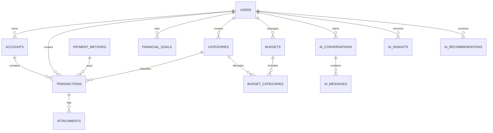

# FinTrack AI - Intelligent Financial Management & Advisory

An enterprise-grade web application built with **Laravel 12**, **Bootstrap 5**, and **Chart.js** designed to help individuals and small businesses track financial activities, understand spending patterns, manage budgets, and receive intelligent recommendations powered by an OpenAI-compatible API.

---

## 🛠️ Technology Stack

| Layer | Technology |
|---|---|
| **Backend** | Laravel 12 (PHP 8.2+) |
| **Frontend** | Blade, HTML5, CSS3, JavaScript |
| **UI Framework** | Bootstrap 5 + Bootstrap Icons |
| **Database** | MySQL (with SQLite local zero-config fallback) |
| **Authentication** | Session-based Custom Auth & Profile Switcher |
| **Charts & Visualizations** | Chart.js 4 (Bar, Line, Doughnut) |
| **AI Integration** | OpenAI-compatible API (`gpt-4o-mini`, Gemini, local LLM) with built-in heuristic fallback engine |
| **PDF Reports** | Barryvdh DomPDF |
| **Excel Exports** | Laravel Excel (Maatwebsite/Excel + PhpSpreadsheet) |
| **Background Jobs** | Laravel Queue (Database driver) |
| **API Authentication** | Laravel Sanctum (Bearer Token) |
| **Testing** | PHPUnit 11 (11 tests, 30 assertions, 100% passing) |
| **Version Control** | Git + GitHub ready |

---

## 🚀 Key Modules & Capabilities

### Module 1 – Dashboard
- **Total Income & Expenses**: Month-to-date and all-time aggregate tracking.
- **Current Net Liquid Balance**: Consolidated across active checking, savings, credit cards, and cash accounts.
- **Monthly Savings & Savings Rate (%)**: Real-time savings retention indicator.
- **Income vs Expense Cashflow Trend Chart**: 6-month historical trend powered by Chart.js.
- **Spend by Category Chart**: Interactive doughnut visualization showing category distribution.
- **Recent Transactions Feed**: Live itemized transactions with category badges and account tags.
- **Budget Utilization Gauges**: Progress bars with color-coded safety thresholds (<80% normal, 80-99% warning, 100%+ exceeded).
- **Financial Overview & Quick Actions**: 1-click transaction entry modal accessible anywhere in the application.

### Module 2 – Transactions & Multi-Account Management
- Incomes, Expenses, and Transfers between accounts.
- Automated balance recalculation on both source and destination accounts.
- Filtering by date range, account, category, type, and keyword search.

### Module 3 – Budgets & Spending Caps
- Monthly budgets per category.
- Visual threshold alerts before overspending.
- Remaining pool tracking.

### Module 4 – Client Invoicing & Billing (Small Business Pro)
- Professional client invoice creation with line items, tax percentage, and discount calculation.
- One-click DomPDF invoice generation and download.
- Lifecycle tracking: Draft &rarr; Sent &rarr; Paid &rarr; Overdue.

### Module 5 – Reports & Exports
- **DomPDF Monthly Financial Statements**: Executive summary suitable for accountants and tax filing.
- **Excel (.xlsx) & CSV Exports**: Itemized export of transactions via Laravel Excel.

### Module 6 – AI Financial Intelligence & Copilot (Core Differentiator)
Finora AI differentiates itself from ordinary expense trackers through autonomous intelligence, pattern detection, and personalized conversational advice:

- **AI Financial Chat Assistant (Core Feature)**:
  - Users query their financial ledger in natural language:
    - *"How much did I spend this month?"* &rarr; Computes real-time expenditures in user currency (`₹32,000` across completed transactions with daily average spend).
    - *"Which category has the highest expenses?"* &rarr; Identifies `#1` cost driver (`Shopping` at `₹12,500`, 39.1% of spend).
    - *"How can I save ₹5,000 next month?"* &rarr; Analyzes discretionary categories and delivers actionable reduction quotas.
    - *"Compare my expenses with last month."* &rarr; Month-over-month variance with category trend breakdown (`Food +20%`).
  - Summarized, authorized row-level security ensures the AI only processes records belonging to the authenticated user.
  - Multi-provider support (OpenAI `gpt-4o-mini`, Google Gemini, local Ollama) with deterministic Finora Local Intelligence fallback.

- **AI Spending Analysis**:
  - Continuous pattern detection on actual records:
    - `Food expenses increased by 20%.`
    - `Shopping is your highest expense category.`
    - `Your savings rate decreased this month.`
    - `Your transport expenses are within budget.`

- **AI Budget Recommendations**:
  - Automated budget surplus optimization:
    - Evaluates Monthly Income (`₹40,000`), Monthly Expenses (`₹32,000`), Net Savings (`₹8,000`).
    - Suggestion: *"Review discretionary spending and consider setting a monthly savings target of ₹10,000."*
    - One-click application directly into the user's active budgets.

### Module 7 – REST API Endpoint Architecture (`/api/v1`)
Enterprise-ready RESTful APIs for Blade AJAX calls, mobile apps (Flutter/React Native/iOS/Android), and external system integrations.

#### 🔐 Authentication APIs
| Method | Endpoint | Purpose | Protection |
|---|---|---|---|
| `POST` | `/api/v1/register` | Register new user & issue Sanctum token | `throttle:10,1` |
| `POST` | `/api/v1/login` | Authenticate user & issue Sanctum token | `throttle:10,1` |
| `POST` | `/api/v1/logout` | Revoke current access token | `auth:sanctum` |
| `GET` | `/api/v1/user` | Fetch current user profile, balance & roles | `auth:sanctum` |
| `POST` | `/api/v1/forgot-password` | Password reset dispatch | `throttle:10,1` |

#### 💳 Transaction APIs
| Method | Endpoint | Purpose | Protection |
|---|---|---|---|
| `GET` | `/api/v1/transactions` | Paginated list with filtering (type, month, category) | `auth:sanctum`, `throttle:60,1` |
| `POST` | `/api/v1/transactions` | Create transaction & adjust balance | `auth:sanctum`, `DB::transaction` |
| `GET` | `/api/v1/transactions/{id}` | View transaction details & attachments | `auth:sanctum`, `TransactionPolicy` |
| `PUT` | `/api/v1/transactions/{id}` | Update transaction & recalculate balance | `auth:sanctum`, `TransactionPolicy` |
| `DELETE` | `/api/v1/transactions/{id}` | Soft delete transaction & restore balance | `auth:sanctum`, `TransactionPolicy` |
| `GET` | `/api/v1/transactions/summary` | Income, expense & net metrics summary | `auth:sanctum` |

#### 📊 Budget APIs
| Method | Endpoint | Purpose | Protection |
|---|---|---|---|
| `GET` | `/api/v1/budgets` | List budgets with utilization, spent & status | `auth:sanctum` |
| `POST` | `/api/v1/budgets` | Create monthly or yearly budget | `auth:sanctum` |
| `GET` | `/api/v1/budgets/{id}` | View budget details & allocations | `auth:sanctum`, `BudgetPolicy` |
| `PUT` | `/api/v1/budgets/{id}` | Update budget caps & thresholds | `auth:sanctum`, `BudgetPolicy` |
| `DELETE` | `/api/v1/budgets/{id}` | Soft delete budget | `auth:sanctum`, `BudgetPolicy` |
| `GET` | `/api/v1/budgets/{id}/progress` | Real-time budget progress metrics | `auth:sanctum`, `BudgetPolicy` |

#### 🤖 AI Assistant APIs
| Method | Endpoint | Purpose | Protection |
|---|---|---|---|
| `POST` | `/api/v1/ai/chat` | Ask AI a question (multi-turn conversation) | `auth:sanctum` |
| `GET` | `/api/v1/ai/conversations` | List conversation threads & message count | `auth:sanctum` |
| `GET` | `/api/v1/ai/insights` | View active spending anomaly insights | `auth:sanctum` |
| `POST` | `/api/v1/ai/analyze` | Trigger financial health score audit | `auth:sanctum` |
| `GET` | `/api/v1/ai/recommendations` | View saving suggestions with potential ROI | `auth:sanctum` |
| `POST` | `/api/v1/ai/summarize` | Generate monthly executive digest | `auth:sanctum` |

#### 📈 Report & Analytics APIs
| Method | Endpoint | Purpose | Protection |
|---|---|---|---|
| `GET` | `/api/v1/reports/monthly` | Full monthly report with trends & breakdown | `auth:sanctum` |
| `GET` | `/api/v1/reports/yearly` | Annual financial statement & month-by-month trend | `auth:sanctum` |
| `GET` | `/api/v1/reports/categories` | Category-wise expenses rollup | `auth:sanctum` |
| `GET` | `/api/v1/reports/export/pdf` | Download formatted PDF statement | `auth:sanctum` |
| `GET` | `/api/v1/reports/export/excel` | Download XLSX / CSV ledger export | `auth:sanctum` |

---

## 🗄️ Database Architecture & Relational Design

The system is designed on a relational MySQL database with multi-tenant row-level security (`user_id` ownership isolation). Every financial record is associated with its owner so that one user can never access or modify another user's transactions.

### Core Database Tables

| Table | Purpose |
|---|---|
| `users` | User accounts, credentials, default currency (`INR`), profile, and AI provider settings |
| `roles` | User roles (Spatie Permission package) |
| `permissions` | Granular access permissions (Spatie Permission package) |
| `categories` | Income and expense categories with parent-child subcategories |
| `transactions` | All financial transactions with accounts, categories, and payment methods |
| `payment_methods` | Cash, UPI, card, bank payment methods |
| `accounts` | Cash, savings, checking, and bank accounts |
| `budgets` | Monthly and yearly category budgets |
| `budget_categories` | Category budget allocations with threshold limits |
| `recurring_transactions` | Scheduled recurring expenses and automated cadence processing |
| `attachments` | Polymorphic receipts and bills attached to transactions |
| `financial_goals` | Savings goals with target deadlines and progress tracking |
| `notifications` | Budget, spending anomaly, and transaction alerts |
| `ai_conversations` | AI chat sessions and thread history |
| `ai_messages` | AI conversation messages with role and token usage |
| `ai_insights` | Generated financial insights, monthly digests, and health scores |
| `ai_recommendations` | Actionable AI saving recommendations with potential savings |
| `audit_logs` | Important system activity, security events, and audit trail |

*Laravel package tables also include migrations for queues (`jobs`, `job_batches`, `failed_jobs`), `cache`, `sessions`, and Spatie permissions (`model_has_roles`, `model_has_permissions`, `role_has_permissions`).*

### Entity-Relationship Diagram (ERD)



### 7 Core Database & Financial Rules

1. **`DECIMAL(15,2)` for Money**: Never `FLOAT` or `DOUBLE` — prevents floating-point inaccuracies during ledger summation.
2. **Foreign Keys & Referential Integrity**: Full foreign keys with appropriate cascade constraints (`cascadeOnDelete` for owner removal, `nullOnDelete` for category removal).
3. **Consistent Timestamps**: Explicit dates (`transaction_date`, `start_date`, `end_date`) and microsecond-consistent created/updated timestamps.
4. **Soft Deletes**: Enabled on all vital financial tables (`transactions`, `accounts`, `budgets`, `recurring_transactions`, `financial_goals`, `invoices`) via `SoftDeletes` trait.
5. **Preserve Transaction History**: Categories use `ON DELETE SET NULL`. Deleting a category never deletes or alters transaction history.
6. **Explicit Currency with Default `INR`**: All monetary records store currency explicitly, defaulting to Indian Rupee (`INR`) with full multi-currency flexibility (USD, EUR, GBP).
7. **Database Transactions**: Multi-record mutations (transaction entry, account balance updates, recurring execution) execute inside atomic `DB::transaction()` blocks.

---

## 📁 Laravel 12 Domain Folder Structure

The project strictly follows domain-driven architecture organizing controllers, services, requests, models, and views by domain:

```text
finora-ai/
│
├── app/
│   ├── Models/
│   │   ├── User.php
│   │   ├── Account.php
│   │   ├── Transaction.php
│   │   ├── Category.php
│   │   ├── Budget.php
│   │   ├── FinancialGoal.php
│   │   ├── AiInsight.php
│   │   ├── AiConversation.php
│   │   ├── AiMessage.php
│   │   ├── AiRecommendation.php
│   │   ├── BudgetCategory.php
│   │   ├── PaymentMethod.php
│   │   ├── RecurringTransaction.php
│   │   ├── Attachment.php
│   │   ├── Notification.php
│   │   └── AuditLog.php
│   │
│   ├── Http/
│   │   ├── Controllers/
│   │   │   ├── Admin/
│   │   │   │   └── AdminController.php
│   │   │   ├── Auth/
│   │   │   │   └── AuthController.php
│   │   │   ├── DashboardController.php
│   │   │   ├── TransactionController.php
│   │   │   ├── CategoryController.php
│   │   │   ├── AccountController.php
│   │   │   ├── BudgetController.php
│   │   │   ├── ReportController.php
│   │   │   └── AIController.php
│   │   ├── Requests/
│   │   │   ├── StoreTransactionRequest.php
│   │   │   └── StoreBudgetRequest.php
│   │   └── Middleware/
│   │
│   ├── Services/
│   │   ├── TransactionService.php
│   │   ├── DashboardService.php
│   │   ├── BudgetService.php
│   │   ├── ReportService.php
│   │   ├── AI/
│   │   │   ├── AIClient.php
│   │   │   ├── FinancialAnalysisService.php
│   │   │   ├── AIChatService.php
│   │   │   └── InsightGeneratorService.php
│   │
│   ├── Jobs/
│   │   ├── GenerateMonthlyInsights.php
│   │   └── ProcessRecurringTransactions.php
│   │
│   └── Notifications/
│       ├── BudgetAlertNotification.php
│       └── UnusualExpenseNotification.php
│
├── database/
│   ├── migrations/
│   ├── seeders/
│   └── factories/
│
├── resources/
│   ├── views/
│   │   ├── layouts/
│   │   ├── auth/
│   │   ├── dashboard/
│   │   ├── transactions/
│   │   ├── categories/
│   │   ├── accounts/
│   │   ├── budgets/
│   │   ├── goals/
│   │   ├── reports/
│   │   ├── ai-assistant/
│   │   └── admin/
│   ├── css/
│   └── js/
│
├── routes/
│   ├── web.php
│   ├── api.php
│   └── console.php
│
├── storage/
├── tests/
│   ├── Feature/
│   └── Unit/
│
├── .env
├── composer.json
└── README.md
```

---

## ⚡ Quick Start & Setup

### 1. Requirements
- PHP 8.2+ with `pdo_mysql`, `pdo_sqlite`, `zip`, `mbstring`, `curl`
- Composer 2+
- Node.js 18+ & NPM

### 2. Installation
```bash
# Clone the repository
git clone <repository-url>
cd fintrack-ai

# Install PHP dependencies
composer install

# Install NPM dependencies and build assets
npm install
npm run build

# Environment Setup
cp .env.example .env
php artisan key:generate

# Run Database Migrations & Seed Demo Data
php artisan migrate --seed
```

### 3. Demo Credentials
The seeder pre-populates realistic data for instant demonstration:

| Profile | Email | Password | Role |
|---|---|---|---|
| **Alex Morgan** | `alex@example.com` | `password123` | Small Business Pro (Apex Digital Solutions LLC) |
| **Sarah Connor** | `sarah@example.com` | `password123` | Individual Tracker |

*(Both accounts feature 1-click auto-fill buttons on the login page)*

### 4. Running the Application
```bash
# Start local PHP server
php artisan serve

# (Optional) Start queue worker for background reports & AI audits
php artisan queue:work

# (Optional) Start schedule runner for recurring transactions & monthly insights
php artisan schedule:work
```
Open [http://localhost:8000](http://localhost:8000) in your browser.

---

## 🧪 Running Automated Tests
```bash
php artisan test
```
All **82 tests** across authentication, database architecture, multi-tenant isolation, budgets, transactions, AI assistant, reports, advanced features (OCR, recurring expenses, anomaly detection, currency conversion, audit logs, subscriptions), and Sanctum API pass with **664 assertions** (100% success).
